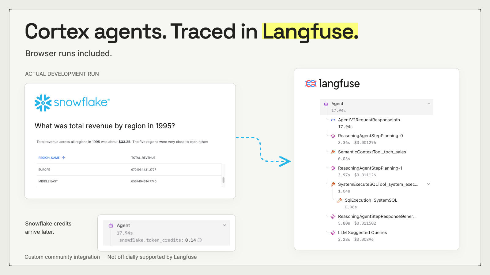
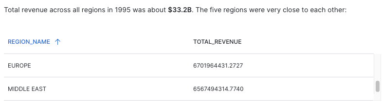
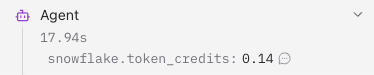
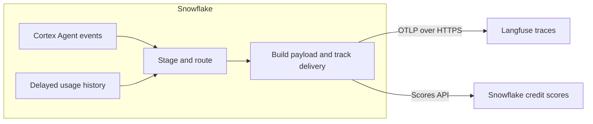

# Snowflake Cortex → Langfuse

Export Cortex Agent traces to Langfuse, including runs made in Snowflake’s browser UI. The exporter runs inside Snowflake using SQL, Python stored procedures and scheduled tasks.

> **Custom community project. Not an officially supported Langfuse component.**
> Built and maintained by Boris Michel. This project is not an official Snowflake integration and carries no vendor support commitment.



[Install](docs/INSTALL.md) · [Configure agent/project mapping](sql/03a_destination_and_routes.sql) · [Operate and recover](docs/OPERATIONS.md) · [Validation status](docs/STATUS.md)

## Why this exists

I wanted to inspect what happened between a question to a Cortex agent and its answer, even when I ran it directly in Snowsight. This project exports the telemetry Snowflake records so those runs can be inspected in Langfuse alongside other AI applications.

The original V1 was demonstrated with live browser runs. **The code here includes newer routing safeguards tested offline, but not yet compiled or exercised in Snowflake.** Start in a disposable environment. A fresh-account manual installation and live multi-project checks are still outstanding.

## What you can inspect

- **Agent runs and conversations:** current question and answer at the root, with user and session identifiers where available.
- **Model and tool steps:** recorded hierarchy, timings, model context, tool calls and SQL execution.
- **Message roles:** an adapter separates recognised injected system context from user messages, with [known parsing limits](docs/LIMITATIONS.md).
- **Usage and credits:** normalised token usage for the verified model convention, plus delayed Snowflake credit scores on the root observation.

<table>
<tr><td width="60%"></td><td></td></tr>
</table>

*Real development screenshots, cropped to remove account and personal details. Dollar estimates visible in the trace tree are separate from Snowflake credit scores. These captures show an earlier V1 run, not proof of the newer routing code.*

## How it works



There is no external worker to run. The exporter reads `SNOWFLAKE.LOCAL.AI_OBSERVABILITY_EVENTS` and joins billing from `SNOWFLAKE.ACCOUNT_USAGE.CORTEX_AGENT_USAGE_HISTORY`. It sends selected telemetry **out of Snowflake** to your configured Langfuse host using an external access integration and Snowflake secrets.

This is a polling exporter, not live instrumentation. The supplied schedule is every 15 minutes; eligibility also depends on source availability and a span-age threshold. Neither a watermark nor a successful task run proves delivery.

## Choose where each agent goes

The configuration lives in **[03a_destination_and_routes.sql](sql/03a_destination_and_routes.sql)**. It declares destination projects and the complete active routing map.

| Layout | Configuration |
| --- | --- |
| All agents → one Langfuse project | One destination and an `ACCOUNT` route |
| Several agents → one shared project | Several `AGENT` routes with the same destination |
| Each agent → a different project | One destination per project and one `AGENT` route per agent |
| Shared default with team exceptions | `ACCOUNT` default with `SCHEMA` or `AGENT` overrides |
| Omit development agents | An `EXCLUDE` rule for their schema or agent |

Precedence is **AGENT → SCHEMA → DATABASE → ACCOUNT**. Names match exactly. Ambiguous or invalid winning routes are held for correction. Each trace has one destination, frozen when routing resolves; changing the map does not move already-routed traces. Fan-out is not implemented.

Project mapping alone does not grant access: each destination also needs its own verified credentials, network permission and procedure secret binding. See [installation](docs/INSTALL.md#prerequisites-and-credentials).

## Get started

You need an eligible Snowflake account with a used Cortex Agent, the account privileges described in [setup](docs/SETUP.md), and a Langfuse v4 project with API keys.

1. Read the [limitations](docs/LIMITATIONS.md), then configure the intended projects and agent scope.
2. Follow [INSTALL.md](docs/INSTALL.md) in order using Snowsight worksheets. Keep API keys in a private secret-creation worksheet.
3. Publish one fresh canary trace. Read it back, check message roles and session display, and verify the destination project.
4. Enable scheduled publication only after those checks pass. Run one publisher at a time.

**No AI agent is required.** The manual path uses the supplied SQL/Python scripts. An [optional AI-assisted path](docs/INSTALL.md#optional-ai-assisted-path) follows the same files and checks.

Do not execute every SQL file as one batch: `99_uninstall.sql` is destructive.

## Traces first, or wait for credits?

| Mode | Behaviour |
| --- | --- |
| `TRACE_FIRST` | Publish eligible traces before billing is available; credit scores follow later. |
| `COST_READY` | Hold traces until the configured billing components are available; credit scores still publish separately. |

Snowflake documents up to one hour of latency for the usage view, with SQL query credits lagging the rest of the row by up to eight hours. Credits are not USD, and waiting for them does not make trace-plus-score delivery atomic. [Snowflake usage reference](https://docs.snowflake.com/en/sql-reference/account-usage/cortex_agent_usage_history).

## Status and limits

| Check | Status |
| --- | --- |
| Earlier V1 browser traces and root credit scores | Demonstrated during development |
| Current routing and delivery safeguards | 21 offline tests |
| Current snapshot compiled/deployed in Snowflake | Not yet verified |
| Clean manual install in a fresh account | Not yet verified |
| Live routing across two projects | Not yet verified |
| Exactly-once delivery / concurrent publishers | Not provided |

Langfuse v4 observations are immutable. Do not resend accepted spans to update them. Uncertain sends need reconciliation; late spans are detected but not exported. Feedback export is not implemented. See [limitations](docs/LIMITATIONS.md) and the [live acceptance checklist](docs/STATUS.md).

## Data handling

The setup grants access to unredacted agent telemetry. Prompts, responses, SQL, tool results and identifiers may be sent to Langfuse. Review your intended scope and destination before staging or publishing; an account-wide route can include historical runs and future agents. This project does not add a general-purpose content redaction layer.

Never attach credentials, raw customer prompts or unredacted payloads to GitHub issues. See [contribution guidance](CONTRIBUTING.md).

## Develop and contribute

```sh
python3 -m unittest discover -s tests -v
```

Python 3.11 is used in CI. These tests check the embedded Python handlers and routing decisions with mocks; they do not replace Snowflake integration tests. The most useful contributions now are a documented fresh-account install, live multi-project canaries and failure-path validation.

Questions and reproducible bugs belong in this repository’s issues. There is no support SLA; please do not treat Langfuse or Snowflake support as the maintainer of this custom exporter.

## Licence and attribution

Project code and original documentation are available under the [MIT licence](LICENSE). Langfuse and Snowflake names, logos and product screenshots remain the property of their respective owners; the MIT licence does not grant rights to those third-party assets or trademarks. [Asset sources and notices](docs/assets/NOTICE.md).
